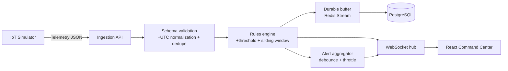

# Smart Campus IoT Monitoring Dashboard

Nền tảng MVP để mô phỏng cảm biến hạ tầng trong campus, phát hiện bất thường theo thời gian thực và hiển thị cho Team Lead qua Command Center.

> Mục tiêu của phiên bản đầu: chạy được **2 loại telemetry** - nhiệt độ phòng máy chủ và công suất điện - từ simulator đến dashboard qua WebSocket, có cảnh báo ngưỡng và lịch sử ngắn hạn.

## 1. Nguyên tắc kiến trúc

Hệ thống ưu tiên một luồng dữ liệu rõ ràng, hợp đồng sự kiện dùng chung và các hàng đợi có giới hạn. Không thành phần nào được tin tưởng dữ liệu đầu vào chưa qua kiểm tra.



### Quyết định nền tảng

- **Monorepo TypeScript**: cùng kiểu dữ liệu cho simulator, backend và frontend.
- **Backend**: Node.js, Fastify/Express, WebSocket (`ws` hoặc Socket.IO), Zod/Ajv để xác thực schema.
- **Frontend**: React + TypeScript; biểu đồ đọc state đã được giới hạn kích thước.
- **Lưu trữ**: PostgreSQL là nguồn dữ liệu chính; Redis Stream là bộ đệm bền vững khi database chậm hoặc tạm mất kết nối.
- **Thời gian**: tất cả timestamp trên wire và database là Unix epoch milliseconds UTC (`timestampMs`). Không dùng giờ cục bộ để so sánh hay sắp xếp.

## 2. Cấu trúc repo sẽ dựng

```text
smart-campus-iot/
├─ apps/
│  ├─ api/                 # Nhận telemetry, rules engine, REST health, WebSocket hub
│  ├─ simulator/           # Phát giả dữ liệu sensor và các tình huống lỗi
│  └─ dashboard/           # React Command Center
├─ packages/
│  └─ contracts/           # Schema, type và hằng số event dùng chung
├─ infra/
│  ├─ docker-compose.yml   # PostgreSQL + Redis cho local development
│  └─ migrations/          # Schema database
├─ docs/
│  └─ decisions/           # Architecture Decision Records (ADR)
└─ README.md
```

`packages/contracts` là ranh giới quan trọng nhất: simulator và UI không được tự định nghĩa lại payload. Mọi thay đổi wire contract phải tăng `schemaVersion` và được review.

## 3. Hợp đồng dữ liệu cốt lõi

### Telemetry gửi vào backend

```json
{
  "schemaVersion": 1,
  "type": "telemetry",
  "messageId": "0cbe3ee4-5cc1-4c5c-8e82-6bc87c81cf04",
  "sensorId": "srv-room-01-temp",
  "metric": "temperature_c",
  "value": 27.4,
  "unit": "celsius",
  "timestampMs": 1791772800000,
  "sequence": 1842
}
```

Schema bắt buộc kiểm tra trước khi vào pipeline:

- `messageId` là UUID, dùng để dedupe trong một cửa sổ thời gian.
- `sensorId`, `metric`, `unit` phải thuộc allow-list đã đăng ký.
- `value` phải là số hữu hạn và nằm trong miền vật lý hợp lệ; JSON thiếu trường, sai kiểu hoặc thừa cấu trúc quan trọng bị từ chối.
- `timestampMs` là số nguyên UTC. Server ghi nhận thêm `receivedAtMs`; dữ liệu lệch quá xa được gắn cờ, không âm thầm sửa thời gian gốc.
- `sequence` tăng dần theo sensor. Event đến trễ vẫn có thể lưu lịch sử, nhưng không được ghi đè điểm mới hơn trên biểu đồ realtime.

### Event backend phát cho dashboard

```json
{
  "schemaVersion": 1,
  "type": "telemetry.update",
  "data": {
    "sensorId": "srv-room-01-temp",
    "metric": "temperature_c",
    "value": 27.4,
    "unit": "celsius",
    "timestampMs": 1791772800000,
    "sequence": 1842,
    "quality": "good"
  }
}
```

Event cảnh báo dùng `type: "alert.open" | "alert.update" | "alert.resolved"` và tối thiểu có `alertId`, `dedupeKey`, `severity`, `rule`, `sensorId`, `openedAtMs`, `latestValue`. Cảnh báo được đẩy qua kênh ưu tiên cao hơn telemetry.

## 4. Rules engine cho MVP

Hai metric khởi tạo và ngưỡng mặc định (để demo, phải đưa vào cấu hình trước production):

| Metric | Sensor mẫu | Cảnh báo | Nguy cấp | Window |
| --- | --- | ---: | ---: | ---: |
| `temperature_c` | `srv-room-01-temp` | >= 28 C | >= 32 C | 10 mẫu / 60 giây |
| `power_kw` | `building-a-main-power` | >= 12 kW | >= 15 kW | 10 mẫu / 60 giây |

Thứ tự xử lý một điểm đo:

1. Validate JSON, chuẩn hóa UTC và dedupe theo `messageId`.
2. Ghi vào ring buffer theo `sensorId + metric`; chỉ giữ đủ dữ liệu cho sliding window.
3. Đánh giá ngưỡng tức thời và bất thường thống kê (chỉ khi window có ít nhất 5 mẫu; điểm lệch `>= 3` độ lệch chuẩn được gắn `anomaly`).
4. Gom cảnh báo theo `dedupeKey = sensorId:metric:rule`; debounce 5 giây và throttle các lần update tiếp theo để tránh alert storm.
5. Đưa telemetry vào buffer bền vững, phát realtime cho client, rồi worker ghi database theo batch.

Không dùng thuật toán thống kê để che lấp một giá trị vượt ngưỡng: vượt ngưỡng luôn mở hoặc cập nhật cảnh báo ngay.

## 5. Khả năng chịu lỗi bắt buộc

| Rủi ro | Hành vi cần có từ đầu |
| --- | --- |
| Sensor hoặc mạng mất kết nối | UI chuyển `reconnecting`, hiển thị dữ liệu cuối cùng là `stale`; reconnect exponential backoff có jitter. Simulator cần hỗ trợ gửi lại từ `sequence` gần nhất. |
| JSON lỗi hoặc dữ liệu rác | Chặn tại ingress, log lý do đã được sanitize, tăng metric `telemetry_rejected_total`; không broadcast dữ liệu lỗi. |
| Nhiều WebSocket event cùng lúc | Xử lý theo hàng đợi tuần tự theo sensor/metric và bỏ event đã cũ theo `sequence`/`timestampMs`. |
| Browser tăng bộ nhớ | Dashboard giữ FIFO tối đa **300 điểm/series** và một bounded message queue; dọn listener/timer khi unmount. |
| Alert storm | Aggregate ở server theo `dedupeKey`; telemetry có thể batch, alert không được đánh rơi. |
| PostgreSQL không sẵn sàng | Mở circuit breaker; ghi vào Redis Stream trước, worker retry với exponential backoff. Chỉ báo `persistenceDegraded` khi buffer gần ngưỡng. |
| Client chậm | Mỗi connection có outbound queue giới hạn; có thể drop telemetry cũ nhưng không drop event alert hoặc trạng thái hệ thống. |

## 6. Mô hình dữ liệu tối thiểu

```text
sensors(id, name, location, metric, unit, is_active, created_at_ms)
telemetry(id, message_id, sensor_id, metric, value, unit, timestamp_ms, received_at_ms, sequence, quality)
alerts(id, dedupe_key, sensor_id, metric, rule, severity, status, opened_at_ms, updated_at_ms, resolved_at_ms, latest_value, occurrences)
```

Index bắt buộc: `telemetry(sensor_id, timestamp_ms DESC)`, unique `telemetry(message_id)`, và `alerts(dedupe_key, status)`. Tầng API không được trả toàn bộ lịch sử; truy vấn lịch sử luôn có time range và limit.

## 7. Mốc triển khai đầu tiên

1. **Contracts** - Khởi tạo `packages/contracts`, schema telemetry/event và unit test cho input hợp lệ, invalid JSON, timestamp lệch, duplicate, out-of-order.
2. **Backend + simulator** - Dựng ingestion, Redis/PostgreSQL local, worker persistence, WebSocket hub; simulator phát 2 sensor cùng kịch bản normal/high/disconnect/noise.
3. **Rules** - Ring buffer, threshold, sliding window, alert dedupe/debounce và kiểm thử alert storm.
4. **Dashboard** - Connection badge, hai chart FIFO, panel cảnh báo, trạng thái stale/reconnecting và cleanup listener.
5. **E2E** - Chạy simulator, ngắt DB, bơm JSON sai và burst event; xác nhận dashboard vẫn phản hồi và dữ liệu được replay khi DB hồi phục.

## 8. Phân công theo blueprint

| Vai trò | Chủ sở hữu phần việc đầu tiên |
| --- | --- |
| Team Lead | Chốt contract/ADR, giới hạn MVP, test acceptance và điều phối integration. |
| Backend | Simulator, ingestion validation, database schema, Redis buffer, WebSocket hub. |
| Algorithms | Sliding window, threshold/anomaly rules, dedupe, debounce/throttle và test edge cases. |
| Frontend | Command Center, WebSocket client queue, chart FIFO, reconnection state và performance cleanup. |

## 9. Definition of Done cho MVP

- Simulator phát được hai sensor và dashboard cập nhật dưới 1 giây trong môi trường local.
- Payload sai không đi qua pipeline; payload lặp không tạo điểm hoặc alert lặp.
- Vượt ngưỡng mở cảnh báo, alert storm được gộp, và cảnh báo không mất khi client chậm.
- UI hiển thị `reconnecting`/`stale` khi stream đứt; bộ nhớ chart bị giới hạn.
- Khi PostgreSQL quay lại, worker replay buffer và không tạo bản ghi trùng `messageId`.
- Toàn bộ thời gian trong event, database và chart dựa trên UTC epoch milliseconds.

---

Tài liệu này là điểm khởi đầu của repo. Bất kỳ thay đổi nào phá vỡ hợp đồng event, semantics cảnh báo hoặc chính sách dữ liệu phải đi kèm ADR và cập nhật tests.
